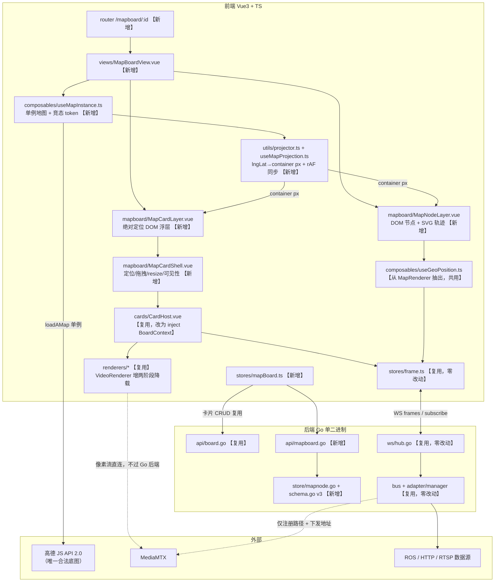
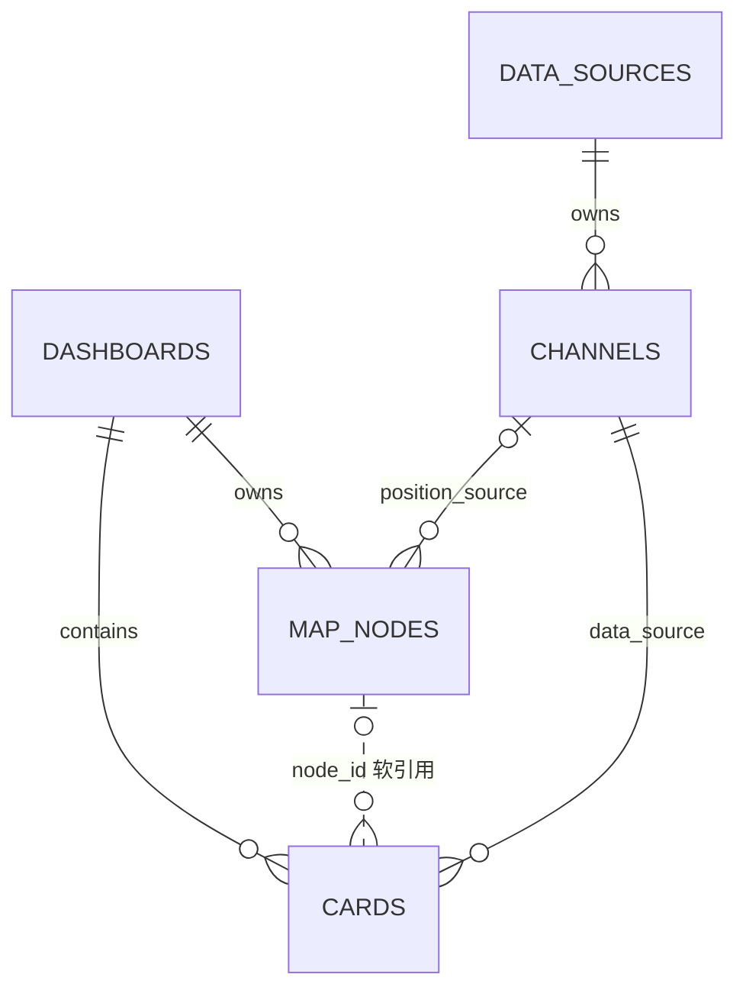

# MonitorAll 系统第三版计划书 —— 全局地图看板（MapBoard）

> 版本：v3.0 计划书（草稿）
> 编制：全栈架构交付专家团（首席交付架构师 高屋建 汇编）
> 日期：2026-10-09
> 事实基础：`/home/jack/monitorAll` 现有代码 + `docs/DEVELOPMENT.md` + `note/01~07`
> ⚠️ `note/README.md` 已明确：早期 PRD/架构文档结论有误且已删除，**以 `note/` 与代码为准**。本计划书的一切结论均经过读码实证。

---

## 0. 摘要与可行性结论

### 0.1 一句话项目定义

**MapBoard（地图看板）是 MonitorAll v3 新增的一种独立看板实体：以合规的高德地图为整块画布底图，把已接入的通道挂载为可移动的地图节点；节点既是位置锚点（由已有 geo 类通道实时驱动、无数据时静态兜底并置灰），也是非 GPS 类卡片（视频 / 仪表 / 折线 / 图像 / JSON / 表格）的宿主；点击节点即在其旁弹出跟随的浮层卡片，卡片可拖拽换位与缩放，并随节点移出地图可视范围自动降载隐藏（视频断流、订阅与 DOM 状态保留），回到视野内快速恢复。**

### 0.2 可行性判定：**全部可实现，无阻断项**

| # | 需求 | 结论 | 落地点 | 代价 / 条件 |
|---|---|---|---|---|
| ① | 地图作为背景 | **能实现** | `MapBoardSurface` 内**单例** `AMap.Map` 铺满容器，卡片浮层是其兄弟层 | 必须把现状「每卡一实例」收敛为单例（见 H2）；无 Key 时需自研虚拟投影器兜底 |
| ② | 移动节点（每节点一 GPS 坐标） | **能实现** | 节点绑定已有 geo 通道 → 位置由 `Projector` 投影 → DOM 节点 `setPosition` 同步 | 需把 `MapRenderer` 的坐标抽取逻辑抽成 `useGeoPosition` 共用；位置更新节流 ≤10Hz |
| ③ | 节点绑定非 GPS 类卡片（lite3 视频流、ROS 话题等） | **有条件实现** | `cards.node_id` 软引用 + `MapCardLayer` 浮层 | 条件：v3 禁止把 `map` 渲染器绑到节点（防嵌套第二个地图实例）；一节点可绑多卡（软上限 4） |
| ④ | 点击节点显示其绑定的卡片 | **能实现** | 节点 DOM click → `toggleNodeCards` → 浮层挂载 `CardHost` | 需抑制"点击节点同时触发取消选中"的双触发 |
| ⑤ | 卡片跟随节点（默认固定尺寸） | **能实现** | 卡片位置 = `Projector` 投影节点经纬度 + 持久化的 px 偏移；rAF 命令式写 `transform` | 位置**绝不进 Vue 响应式**（20 卡 × 60Hz 会引发 patch 风暴） |
| ⑥ | 卡片拖拽 + 尺寸调整 | **有条件实现** | 自研 `useDragResize`（pointer events + `setPointerCapture`） | 条件：拖拽期间必须暂停该卡的地图同步，否则「外部位置驱动」与「本地拖拽草稿」双向写入打架 |
| ⑦ | 节点移出可视范围自动隐藏卡片 | **能实现** | 投影后 px 与容器矩形比较 + 迟滞 64px + grace 1000ms + 两阶段降载 | 代价：视频卡隐藏后 MediaMTX 无读者 10s 会停流，回视野需重新拉流（1~3s），用两阶段降载缓解 |
| ⑧ | （隐含）≤20 节点 / ≤4 路视频 | **能实现，不做 LOD** | 硬编码钳制 + 配额调度 | 架构上留 `MapNodeLayer` 可替换实现位 |

**真实成本集中在三处**：(a) 地图实例必须收敛为单例并处理 async 生命周期竞态；(b) 卡片浮层与地图手势/事件必须严格分层；(c) 保存语义（revision）的历史包袱。这三处也是本项目「静默失败」的高发区，全部配了可观测出口。

### 0.3 本计划书同时回答的第二件事：现有架构评估

编制过程中对现有系统做了读码实证审查，共发现 **20 项隐藏问题（H1~H20）**，其中 1 项为**发布阻断级**（H9：配置与存储的版本号已漂移），4 项为**v3 必须顺手修的既有缺陷**（H4 / H11 / H12 / H14）。详见第 9 章。

---

## 1. 需求范围

### 1.1 目标场景

| 场景 | 描述 | 现状痛点 |
|---|---|---|
| **S1 单机多传感器巡检（主场景，Lite3 四足）** | 带 Lite3 到外场跑自主巡检，人在笔记本旁守着 | 地图卡只有 1 个点，要看机器狗视角必须回网格找视频卡，要看 IMU 再找折线卡——视线三次跳转让渡 |
| **S2 多机编队位置总览** | 5~20 台同时在场，快速逐台核对"位置对不对、还活着吗" | N 条轨迹需要 N 张地图卡，12 列栅格直接塞爆；一次只能细看一台 |
| **S3 离线回放复现** | 回办公室用 `replay` 数据源重放记录的 GPS + 同步数据复盘 | **v3 前置能力缺失**（见 H1），已列为 v3.1 |

### 1.2 MVP 范围（v3.0 Must）

1. **看板实体**：MapBoard 的创建/进入/刷新保持/重命名/删除，与网格 Dashboard 并列；编辑/查看两态；改动自动持久化。
2. **节点**：从已有 geo 类通道创建；静态兜底坐标；≥3s 无帧 → stale 置灰；坐标系声明（看板级默认 + 节点级覆盖）；删除/解绑。规模 ≤20。
3. **卡片挂载**：节点绑定非 GPS 卡片，复用现有 7 类渲染器；点击显示/收起；视频卡不等首帧即挂载。
4. **跟随与排版**：默认跟随节点、默认尺寸、级联偏移；拖拽脱钩 +「回到跟随」；缩放并保持；容器内钳制。
5. **视口感知**：出视口隐藏 + grace 防抖 + 视频断流 + 回视野快速恢复；全程 WS 订阅集合不变。
6. **地图与合规**：单 MapBoard 一张地图；底图样式可切（含卫星图层）；无 Key 降级为虚拟投影器且绝不切境外底图；常驻 CRS 声明。
7. **可观测**：Key 缺失 / 字段路径取不到值 / 持久化失败 / 节点与卡片计数，都有可见出口；诊断 HUD 收敛为正式可开关层。

### 1.3 明确不做（Out of Scope）与原因

| 不做项 | 原因 |
|---|---|
| 节点聚类、LOD、>20 节点 | 规模已界定为 ≤20；聚类会引入"点开到底是哪个"的语义歧义，收益为负。数据模型留扩展位 |
| 节点间连线/编队/拓扑关系 | S1~S3 均未要求"看它们相对关系"，且缺关系数据来源定义 |
| 跨会话历史轨迹落库 | 写放大 + WAL 膨胀，与"节点位置不落库"裁决一致；会话内尾迹为 Could |
| 卡片自动避让 | 体验增量，MVP 用"默认偏移 + 手动拖"兜住；自动避让越做越难 |
| 移动端/触屏适配、权限/多用户 | 用户实际是笔记本；现有系统无鉴权 |
| 内网自托管瓦片底图 | 与「底图仅高德」合规红线冲突 |
| 网格看板一键转 MapBoard 的迁移工具 | 两种语义不同（自由布局 vs 位置锚定），自动迁移多半要重摆 |
| MapBoard 内嵌时间轴/回放进度条 | 依赖 H1 前置能力补齐，列 v3.1 |

### 1.4 后续迭代

- **v3.1**：前端补齐 `imports` / `replay` 入口（解锁 S3）；`PUT /channels/:id`（解锁 H19）；网格 `/layout` 一致化（偿还 V3-DEBT-01）；轨迹落库（`telemetry.db` 独立库）。
- **v3.2+**：节点图标/颜色自定义、画外节点方位指示、轨迹尾迹、卡片自动避让、节点分组/图层。

---

## 2. Phase 0 已确认的四项决策（不可推翻）

| # | 决策 | 来源 |
|---|---|---|
| D0-1 | MapBoard 是**独立看板实体**，与网格 Dashboard 并列，**不是**同一看板的视图切换 | 用户拍板 |
| D0-2 | 节点位置 = 绑定已有 geo 通道实时驱动 **+ 静态坐标兜底**（无数据显示兜底坐标并置灰/stale） | 用户拍板 |
| D0-3 | 移出视口 = **降载但不销毁**：视频断流省带宽，保留 WS 订阅与 DOM 状态，回视野快速恢复；需 grace period 防抖 | 用户拍板 |
| D0-4 | 规模 ≤20 节点、同屏视频 ≤4 路。不做聚类/LOD，但留扩展位 | 用户拍板 |

---

## 3. 总体架构

### 3.1 架构图



### 3.2 核心思路：容器可替换，内核不可复制

网格看板与地图看板的差异**只在容器层**（布局 + 定位 + 可见性）。以下五层是共享内核，**一行都不复制**：

| 共享内核 | 复用方式 | 改动 |
|---|---|---|
| `stores/frame.ts`（帧缓冲 / version 触发 / rAF 批量） | 节点位置与卡片数据都走它 | **零改动** |
| `ws/client.ts` + `ws/hub.go`（按连接 Set 订阅 + 适配器引用计数） | 节点通道同样 `subscribe([channelId])` | **零改动**（协议保持 v1，不新增 op） |
| `renderers/*`（渲染器不感知容器） | 渲染器只收 `card + config`，填满父容器 | 仅 VideoRenderer 增可见性降载 |
| `cards/CardHost.vue`（订阅→状态→三态→分发） | 放进浮层 Shell 直接用 | 改：从 `BoardContext` inject（缺省回落 dashboardStore） |
| `utils/geo.ts`（唯一坐标转换点） | 节点与地图卡共用 | **零改动** |

**依赖方向（禁止反向）**：
`MapBoardView → MapBoardSurface → MapNodeLayer / MapCardLayer → MapCardShell → CardHost → renderers → frameStore`
渲染器**不得**反向依赖 mapboard 任何模块；`CardHost` **不得**依赖具体容器。

**硬约束 F-18**：在 `manifests.ts` 注册一个新渲染器后，网格看板与 MapBoard 均可用，**MapBoard 侧改动点 = 0**。

### 3.3 新增契约（provide/inject，均带缺省实现保证网格路径零回归）

```ts
interface BoardContext {
  kind: 'grid' | 'map'
  editMode: Ref<boolean>
  selectedCardId: Ref<string | undefined>
  selectCard(id?: string): void
  patchCard(id: string, body: UpdateCardReq): Promise<Card>
  removeCard(id: string): Promise<void>
  /** grid: 格单位；map: px 单位。实现方决定节流与冲突策略 */
  saveGeometry(items: { id: string; x: number; y: number; w: number; h: number }[]): Promise<void>
}   // 缺省实现 = dashboardStore → 网格路径零改动

interface CardVisibility {
  visible: Ref<boolean>
  reason: Ref<'viewport' | 'quota' | 'unanchored' | 'user' | 'none'>
}   // 缺省 = { visible: true, reason: 'none' }

interface GeoPositionSource {          // 从 MapRenderer 抽出，节点与地图卡共用
  latest: Ref<{ lat: number; lon: number; yaw?: number; t: number } | undefined>  // 已转 GCJ-02
  version: ComputedRef<number>
  stale: ComputedRef<boolean>
  sourceCRS: ComputedRef<CRS>
  getBuffer(): RingBuffer<Frame> | undefined
}

interface Projector {                 // 有 Key / 无 Key 两套实现，同一接口
  readonly kind: 'amap' | 'virtual'
  lngLatToContainer(p: LngLat): { x: number; y: number }
  containerToLngLat(q: { x: number; y: number }): LngLat
  getCenter(): LngLat; setCenter(c: LngLat): void
  getZoom(): number; setZoom(z: number): void
  getSize(): { w: number; h: number }
  on(type: 'move' | 'zoom' | 'resize', cb: () => void): () => void
  destroy(): void
}
```

---

## 4. 技术选型（每项均给出被否决方案）

### 4.1 地图实例：单例（主选）

| 方案 | 结论 | 理由 |
|---|---|---|
| **单例（一个 MapBoard 一个 `AMap.Map`）** | ✅ **主选** | 全局模式语义上就是"一张底图 + 覆盖物"，单例是唯一正确解 |
| 每卡一实例（**现状**） | ❌ 否决 | 见 H2：WebGL 上下文耗尽、Key 配额 N 倍、诊断出口被覆盖、async 卸载泄漏 |
| 卡片内嵌小地图 | ❌ 否决 | 与单例并存即第二个 WebGL 上下文；卡片被拖拽导致地图频繁 resize 重排 |

**单例生命周期设计**：
```
作用域：一个 MapBoard 视图实例（非进程级全局；路由切换可销毁重建）
状态机：idle → creating(含 token) → ready → destroying → idle
API：ensureMap(container) / releaseMap(token) / getMap() / destroyAll()
关键规则：
  R1 无 amapKey / 加载失败 → 返回 null，不创建实例，UI 走虚拟投影降级
  R2 async 竞态：每次 ensureMap 取自增 token；await 返回后若 token 已变 → 立即 destroy 并 return
  R3 ensureMap 必须 Promise 复用（幂等）——token 管"过期废弃"，Promise 复用管"重复创建"，两者正交
  R4 loadAMap 返回 null 的路径也要 token 守卫，不允许过期实例写入"虚拟模式"状态
  R5 销毁：onBeforeUnmount → token++ → 清监听 → map.destroy() → 单例置空
  R6 组件复用（/mapboard/A → /mapboard/B 不触发 unmount）：必须显式 reset
     （清 overlay 注册表 / 应用新 view / 重置位置表·可见集·视频配额·保存队列）
     —— 采用"复用 + reset"而非 :key 强制重建（做单例就是为了省 WebGL 上下文）
  R7 mapBoardStore.hydrate() 需独立 boardId 守卫（A 的响应不能覆盖 B）
  R8 window.__maMap（网格地图卡在用）不要动；MapBoard 用 __maBoardMap
```

### 4.2 节点渲染：统一 DOM/SVG + Projector（主选，即"方案 U"）

| 方案 | 结论 | 理由 |
|---|---|---|
| **统一 DOM/SVG + 同一 Projector**（高德只出瓦片） | ✅ **主选** | ① 与卡片浮层**同源同帧**写入，相对偏移恒等于初始偏移；② 一套实现（无 Key 降级无缝）；③ 消灭第二套交互（Marker 的 click/hover/cursor 热区与 DOM 卡片两套） |
| 有 Key 用 `AMap.Marker` + 无 Key 另写一套 DOM（"方案 S"） | ❌ 否决 | **决定性理由**：Marker 由高德自重定位（零滞后）、卡片由 rAF 同步（必有滞后），惯性 pan/zoom 时会出现"节点跑到新位置、卡片还在旧位置"的相对漂移——**节点甩下卡片自己跑**，比"整组滞后一帧"难看得多 |

配套：DOM 节点可直接 Tab 聚焦（无障碍优于 Marker）；轨迹用 SVG `<polyline>` 以**容器 px 直接画**（与 Projector 输出单位一致，零换算，不用 viewBox）；`amapLoader.ts` 的类型需求因此**收缩**（不需要 Marker/Polyline/Icon/Size）。

### 4.3 卡片浮层：绝对定位 DOM 覆盖层（主选）

| 方案 | 结论 | 理由 |
|---|---|---|
| **绝对定位 DOM 覆盖层**（投影换算 + 监听地图事件 + rAF 同步） | ✅ **主选** | ① 卡片是复杂 Vue 组件树，DOM 主权必须留在 Vue；② 事件分层可控；③ 无 Key 时可整体降级为虚拟投影；④ 与"帧/位置不进响应式、命令式改 DOM"的性能铁律一致 |
| 高德自定义 Overlay | ❌ 否决 | 卡片 DOM 被高德接管 → Vue 的 DOM diff 与高德操作打架；其事件系统会拦截卡片内部交互；无 Key 降级路径要另写一套 |
| 复用 grid-layout-plus 模拟自由定位 | ❌ 否决 | 12 列栅格 + vertical-compact 语义上无法表达"跟随经纬度锚点的像素定位"；px↔格换算引入抖动；且已踩过回环自激振荡（H/note §3.3） |

**三条硬约束**：
- **C1** overlay 容器 `pointer-events: none`，仅卡片与 handle 为 `auto` → 地图 pan/zoom/滚轮在其他区域完全不受影响。
- **C2** 位置更新**只在 rAF 里命令式写** `el.style.transform = translate3d(x,y,0)`，绝不写入响应式 store。
- **C3** 同步触发源收敛为四处：`mapmove`/`zoomchange`/`resize` + 节点位置更新 + 拖拽结束；且用 center/zoom/节点坐标的**真实变化**做前置过滤。

### 4.4 拖拽 / resize：自研 pointer events（主选）

| 方案 | 结论 | 理由 |
|---|---|---|
| **自研 `useDragResize`（pointer events + `setPointerCapture`）** | ✅ **主选** | 只需"拖拽 + resize + 边界钳制 + 阈值防误触"；且位置由外部（地图+节点）驱动，必须自持草稿态 |
| 复用 grid-layout-plus | ❌ 否决 | 栅格语义不匹配；已踩过 `layout-updated` 回环坑 |
| vue-draggable-resizable / interact.js | ❌ 否决 | 组件内部持有 x/y/w/h，而我们需要外部每帧写 transform → **双向写入必回环**（note §3.3 教训）；interact.js 还多 30KB 依赖换 10% 能力 |

**与地图手势不冲突的机制**：
1. overlay 是 map 容器的**兄弟节点**（事件不冒泡进 AMap canvas）
2. 卡片根与 handle：`pointer-events: auto` + `touch-action: none`
3. handle 的 `pointerdown`：`stopPropagation()` + `preventDefault()` + `setPointerCapture()`
4. 拖拽期间该卡 `paused = true` → 地图同步跳过（消灭"打架抖动"）
5. **松手补偿**：`pause` 时记录 `pauseAnchor`，`resume` 时用 `delta` 修正草稿偏移 → 拖拽期间地图动了/GPS 走了，松手也不瞬移
6. 卡片内可滚动区加 `overscroll-behavior: contain`

**z-index 分层（overlay 内部）**：轨迹 `1` → 节点 `2` → 卡片 `10` → 选中 `50` → 拖拽 `100` → 放大/全屏 `150` → HUD/工具条 `200` → Inspector/Drawer（teleport 到 body）`1000+`。满足 U-4「节点层 < 卡片层 < 选中层 < 放大层」。

### 4.5 其余选型

| 领域 | 主选 | 被否决 | 否决理由 |
|---|---|---|---|
| 状态管理 | **新增 `stores/mapBoard.ts`** | 扩展 `dashboardStore` | 上帝 store + 回归面扩大到网格路径 |
| 看板存储建模 | **复用 `dashboards` 表 + `kind`** | 独立 `map_boards` 表 | 需复制整套卡片 CRUD + 订阅引用计数 + revision，API 面翻倍 |
| 卡片几何存储 | **新增 `cards.map_geom`（px）** | 复用 `cards.layout` | 字段语义重载正是本项目静默失败高发模式 |
| 节点位置 | **不落库**（内存 + 复用 replay） | 轨迹表 | 20 节点 ×10Hz ≈ 1728 万条/日、1.4~2.8GB/日，写放大 + WAL 膨胀 |
| WS 协议 | **不升版**，沿用 subscribe/frames | 新增 `nodePosition` op / 升协议 | 复用现有一切即可；升版触发 `WS_PROTOCOL_MISMATCH` 与强制同步发版 |
| 视频降载 | **两阶段**（1s / 10s，自 t0 起算不叠加） | 隐藏即 destroy | MediaMTX `sourceOnDemand` 反复重新拉流黑屏 |
| 无 Key 降级 | **虚拟投影器**（自研 Web Mercator） | 纯坐标列表 | 浮层/可见性/拖拽全依赖投影，列表化等于核心功能整体不可用 |
| 投影实现 | **自算 Mercator + 两级校准** | 直接调 `lngLatToContainer` | 后者在 `mapmove` 期间可能滞后一帧导致卡片拖影（但保留为校准基准与回退开关） |
| 错误码 | **全部复用现有 40003，零新增** | 新增 40011 / 40021 | 40003 `UnsupportedType` 语义已覆盖"kind 不匹配"与"渲染器不支持" |
| 看板 view 配置 | **存 `dashboards.global_config`** | 新增 `PUT /mapboards/:id/view` | 复用已有 JSON blob，缩减 API 面 |

---

## 5. 功能设计方案

### 5.1 功能清单与优先级

| # | 功能 | 优先级 | 验收要点 |
|---|---|---|---|
| F-01 | MapBoard CRUD + 列表并列 + URL 直达 | Must | 列表区分 grid/map；刷新后回到同一看板且状态一致 |
| F-02 | MapBoard 级地图配置（中心/缩放/底图样式/输入 CRS） | Must | 刷新后保持；样式切换真实生效（含卫星图层 remove） |
| F-03 | 单例地图承载 N 个节点 | Must | 20 节点 MapBoard 的 AMap 实例数 = 1（HUD `amapInstances` 可肉眼验证） |
| F-04 | 节点创建（绑 geo 通道）+ 实时移动 | Must | P-01；20 节点同时更新仍达标 |
| F-05 | 静态兜底坐标 + stale 置灰 | Must | 无数据显示兜底 + 标识；恢复数据后自动解除 |
| F-06 | 节点 CRS 声明与离线换算 | Must（合规） | HUD/脚注常驻；与已知路标误差 ≤10m |
| F-07 | 节点绑卡 / 解绑 / 删除 | Must | 可用渲染器 = 现有 7 类；删除节点不影响底层 Channel |
| F-08 | 点击显示/收起浮层卡片 | Must | ≤200ms 出现；非视频卡不出现 loading 态 |
| F-09 | 默认跟随 + 拖拽脱钩 + 回到跟随 | Must | 节点移动卡片跟随且无自激振荡；脱钩后节点移动卡片不动 |
| F-10 | 卡片缩放（视频锁 16:9） | Must | 松手不回弹；刷新后保持 |
| F-11 | 出视口隐藏 + grace 防抖 | Must | P-02 / P-06 |
| F-12 | 视频卡 teardown / 恢复 | Must | P-03 / P-04 / P-05 |
| F-13 | 隐藏/显示不触发 WS 重订阅 | Must | P-08 订阅集合快照前后完全一致 |
| F-14 | 编辑/查看模式 | Must | 查看模式下拖拽/resize/删除入口不响应 |
| F-15 | 自动持久化 + 失败可见出口 | Must | 保存失败必须在画布内可见（不得只进 console） |
| F-16 | 无 Key 虚拟投影降级 | Must（合规） | C-10 零地图请求；核心功能仍可用 |
| F-17 | 诊断 HUD（节点/可见卡/视频路/Key 状态） | Must | 可开关；off 档 DOM 中不存在 |
| F-18 | 渲染器唯一入口约束 | Must（架构） | 新增渲染器后 MapBoard 侧改动 = 0 |
| F-19 | 位置源支持 `geo_pose` 与 JSON 字段路径 | Must | 两种路径 `data.pose.lat` / `root.data.pose.lat` 都命中 |
| F-20 | 同屏数量软/硬限制提示（节点 20 / 视频 4） | Must | 超限显式提示并限制新增，不静默失败 |
| F-30 | 未锚定卡片收纳入口 | Must | 编辑态侧栏「未锚定卡片(N)」，支持 rebind / 删除 |
| F-31 | 渲染器选择器过滤 `map` + 说明文案 | Must | F-A20 |
| F-32 | 删除节点时的卡片处置对话（默认解绑保留） | Must | 禁止无声处理 |
| F-33 | 视频并发上限暂停占位 + 一键恢复 | Must | 仅 `reason='quota'` 才画占位卡 |
| F-21 | 多卡片同开 + 数量限制 | Should | 非视频软上限 6 / 视频硬上限 4 |
| F-22 | 脱离跟随位置持久化 | Should | |
| F-23 | 容器边界钳制/贴边吸附 | Should | 距边 <8px 吸附 |
| F-24 | 追焦选中节点开关 | Should | 可随时关闭且不影响已脱钩卡片 |
| F-25 | 底图样式热切换 | Should | 切回暗色不得残留卫星图层 |
| F-26 | revision 冲突提示 | Should | |
| F-27~29 | 节点图标/颜色、画外方位指示、会话内尾迹 | Could | 尾迹仅内存 ring buffer，不写库 |

### 5.2 关键交互机制

#### (1) 卡片跟随：只在 rAF 里命令式写 transform

- 数据结构：非响应式池 `Map<string, CardTransform>`（`markRaw`），字段含 `el / nodeId / x / y / w / h / dirty / paused / lastAnchor`。
- 同步触发源严格收敛为 4 个：`mapmove`+`zoomchange`（或虚拟投影同义事件）、`ResizeObserver`、节点位置更新（≤10Hz）、拖拽结束。
- **前置过滤（进入 rAF 之前就掐掉）**：
  1. `center`/`zoom`/`size` 三者全同 → 直接 return（高德在同一 center 下也会因内部重绘发 `mapmove`）
  2. 节点更新：投影后位移 < `MAP_SYNC_EPSILON_PX = 0.5` → 跳过该卡
  3. 每卡独立 `dirty` 标记 → rAF 回调只写变化的项
- rAF 回调复用现有 `useRafBatch`（同 key 覆盖 → 一帧最多一次），只写 `transform`；`w/h` 只在 resize 提交或首次挂载时写。
- `will-change: transform` 只给最近 1s 内 dirty 过的卡，全局上限 8 张（防层爆炸）。

#### (2) 投影：自算 Mercator + 两级校准（C27）

| 层 | 做法 |
|---|---|
| 主路径 | 自算 Web Mercator（按 `getCenter()+getZoom()`），与 `VirtualProjector` 共用同一份数学 → 同帧写入、无拖影 |
| 校准 | `moveend`/`zoomend`（静止时）调一次 `lngLatToContainer` 比对得 `driftPx` |
| 一级响应 | 常量偏移 → **自动补偿** |
| 二级响应 | scale 型误差 → **只告警**（HUD `projDrift`）+ 调试开关切回 `lngLatToContainer` 取证 |
| 额外校验 | 比值交叉校验 `res_prev/res_cur === 2^(z_cur − z_prev)`（容差 0.5%），机会式、不打断用户 |

> **U-1（禁旋转/倾斜/3D 楼块）升级为技术前提**：它不只是产品取舍——一旦开 pitch/rotate，投影变透视仿射变换，手算 Mercator 立刻失效。**必须写进 `utils/projector.ts` 文件头**，否则将来有人为"好看"打开倾斜，浮层整体错位且不报错。
> **严禁"自算但从不校验"** —— 那就变成新的静默失败。

#### (3) 视口剔除：迟滞 + 非对称 grace + 两阶段降载

```ts
// 迟滞：进入严格、退出宽松
const H = 64
function intersects(r, size, pad) { return r.x + r.w > -pad && r.x < size.w + pad && r.y + r.h > -pad && r.y < size.h + pad }
// hidden → visible：pad = 0   （必须真的进来了）
// visible → hidden：pad = 64  （必须彻底走远了才走）
```

**时序（以出视野为 t0，三个计时器均自 t0 起算、不串行叠加）**：

```
t0          节点离开可视范围（含外扩 64px）
t0+1000ms   grace 到期且仍隐藏 → 卡片隐藏 【同时】视频进入阶段一
              HLS/FLV：destroy 实例 + 断开拉流 → 下行立即归零（≤500ms）
              WHEP   ：el.pause() → 停止渲染与解码（CPU 归零），画面冻结在最后一帧不黑屏
t0+10000ms  阶段二：WHEP pc.close() → 下行归零；HLS/FLV 阶段一已归零，无动作
任意时刻回视野 → 立即 resume（0ms）：WHEP el.play() 立即出画面；HLS 需 restart
中途回视野 → 计时器清零（不是暂停续算）
WS 订阅全程保留
```

> **MediaMTX 时间线（C4 论证的正确表述）**：「无读者 10s 停上游」的计时起点是 **destroy 之后**，不是出视野之后。
> `t0 出视野 → t0+1s pause（读者仍在、上游仍拉）→ t0+10s destroy（读者归零）→ t0+20s MediaMTX 停上游`。
> 真正的收益窗口是 `t0 → t0+X` 的快速恢复；X 越大代价是多耗全额码流。**X=10s 时，10s→30s 多出的 20s 是纯成本、零收益。**

**视频降载与现有降级编排共存（6 条规则）**：
- V1 `startProbe()` 仅在 `playing && degraded && !lockedProtocol` 时运行；进入 `suspended/shedded` **立即 `stopProbe()`**（否则每 30s 后台建一个 peer 探测，与"省带宽"目标完全相反）
- V2 `watch(urlsSignature)` 在降载态只更新签名，不重启播放
- V3 恢复时不重置 `degraded / lockedProtocol` 决策状态
- V4 恢复失败才走降级链
- V5 降载态手动 `forceProtocol` 只记 `lockedProtocol`，恢复时生效
- V6 `onBeforeUnmount` 无论何种状态都走完整 `teardown()`

**订阅语义（易踩坑，已裁决 C15）**：

| 状态 | DOM | 订阅 |
|---|---|---|
| **出视口隐藏** | 保留 | **保留**（P-08） |
| **超并发暂停（quota）** | 保留 + 占位卡 | 保留，仅停播放器 |
| **未锚定孤儿卡（node_id 为空）** | 不渲染 | **必须释放**（随组件卸载自然退订） |

> 两者语义相反，**不可复用同一段逻辑**。20 节点规模下，未锚定卡片若保留订阅会留下一批看不见的白订阅。
> 利好：`ws/hub.go:153` 在 `Subscribe` 成功时会 `bus.LatestFrame()` 补发最近一帧 → rebind 后立即可见，无需额外代码。

#### (4) 几何保存：本地草稿 → 反算 → debounce 300ms → 串行合并队列

```
pointerup → onCommit(rect)
  → 写入 geomDraft（Math.round 取整 px）
  → 反算锚点偏移 offset = rect.xy − projector.lngLatToContainer(node.lngLat)
  → isGeomEqual(新, 旧) → 相同则直接 return（不入队、不发请求）
  → dirtySet.add(id) → debounce 300ms → flush()
```

**防回环八条规则（逐条可检）**：

| # | 规则 | 防的是什么 |
|---|---|---|
| R1 | **响应不回写草稿**：`PUT /geometry` 返回值只记 `saved` 计数，绝不写回 `geomDraft` | 断掉「回写→新引用→再 emit→再保存」自激环（note §3.3） |
| R2 | 值相同不入队（`isGeomEqual` 用取整后 px 比对） | 抖动产生无意义保存 |
| R3 | 坐标取整 | 浮点抖动不算变化 |
| R4 | 拖拽期间 `paused=true`，且 `draftLock` 阻止外部重建覆盖草稿 | 外部几何覆盖本地 → 视觉跳变 → 再保存 |
| R5 | in-flight 合并：请求进行中的新草稿只进 `pending`，响应后合并再发；永不并发 | 乱序覆盖（旧响应盖新草稿） |
| R6 | 外部重建仅发生在三个时机（首加载 / 节点增删 / 路由切换），且逐项 `isGeomEqual` | 与 `saveLayoutNow` 短路思想一致 |
| R7 | 位置不进响应式（`geomDraft` 是 markRaw Map） | 从根上消除环 |
| R8 | 服务端返回的 `cards[].layout` 在地图看板完全不读不用 | C7 配套 |

#### (5) 卡片尺寸：manifest 唯一权威源

| rendererType | 默认（外框） | 宽高比 | 最小（外框） |
|---|---|---|---|
| **video** | **354×256**（无页脚 354×232） | **锁 16:9，作用于播放区** | 242×193 / 242×167 |
| image | 288×216 | 4:3 不锁 | 200×150 |
| time_series_sample | 360×220 | 不锁 | 240×140 |
| table | 380×260 | 不锁 | 260×180 |
| json | 320×240 | 不锁 | 200×160 |
| scalar（仪表） | 220×180 | 不锁 | 160×140 |
| map | —— | —— | **v3 禁用** |

- 兜底 320×220；上限首次渲染时钳制为容器短边 80%。
- **持久化一律存外框**，内容区由外框反推，不存两套尺寸。
- manifest 契约：`defaultPx?: { w, h, minW, minH, measure: 'outer'|'content', lockAspect?: number }`；video 的 `measure='content'`、`lockAspect=16/9`。
- **chrome 高度单一真源（U-6 / C26）**：
  ```ts
  CARD_CHROME_H(showFooter) = CARD_HEADER_H(32) + (showFooter ? CARD_FOOTER_H(24) : 0) + CARD_BORDER_PX(1) * 2
  // 有页脚 58，无页脚 34
  // video resize：h = round((w - 2) * 9/16) + CARD_CHROME_H(showFooter)
  // 验算：w=354 → (354-2)*9/16 = 198 → 198+58 = 256 ✓；无页脚 198+34 = 232 ✓
  ```
  禁止别处再写 32/24/2 的算术；开发期（dev-only）断言 `card.offsetHeight - body.offsetHeight !== CARD_CHROME_H` → warn，且**文案带期望值与实际值**。

> **两轮订正的经验教训（建议留档）**：默认尺寸这类数字必须**钉死"度量对象"**（播放区 vs 外框）**并读码核对 chrome 构成**。本项目连续两次差之毫厘（先是 336×192 不是严格 16:9，再是漏了卡片自身 1px 边框 ×2），且两次都不报错——正是 `note/03 §3.9` 说的静默失败。

### 5.3 U-1 ~ U-6 架构级约束（必须写进代码注释）

- **U-1** 底图固定 2D 俯视，禁 3D 楼块/旋转/倾斜。**同时是自算 Mercator 成立的技术前提**。
- **U-2** 节点与卡片位置更新**只允许** `transform: translate3d`，禁止每帧读写 `offsetWidth/offsetTop`（P-07 达标前提）。容器尺寸来自 `ResizeObserver` 缓存值。
- **U-3** 节点视觉语言与现有地图卡同源（朝向箭头 + 状态色），把 `MapRenderer.vue:171-179` 的内联 SVG data URI 抽成共享 util `nodeIcon(color, yaw)`；**禁止另建一套位置视觉符号**。
- **U-4** overlay 内层级规则显性化（节点层 < 卡片层 < 选中层 < 放大层）。
- **U-5** 视口判定基于「投影后的容器 px 与容器矩形比较」，**禁止 `map.getBounds().contains()`**。
- **U-6** 浮层卡片必须复用同一套 chrome 单一真源 `CARD_CHROME_H()` 函数，不得为浮层样式重写 header/footer 高度或去掉边框。

---

## 6. 数据库设计摘要（v3 迁移）

### 6.1 ER 关系



**不变量（服务层校验 + 启动自检兜底，DB 无法跨表约束）**：
1. `dashboards.kind='map'` 才能拥有 `map_nodes`
2. `map_nodes.channel_id` 非空时，通道必须存在且 `payload_type ∈ {geo_pose, json, table}`
3. Card 与 Node 必须同板：`card.dashboard_id = map_node.board_id`
4. v3 允许一个 geo 通道被多个节点引用，不加 UNIQUE

### 6.2 v3 迁移 DDL（只增不改）

```sql
-- store/schema.go: migrations 追加 {Version: 3, Name: "add_mapboard"}
ALTER TABLE dashboards ADD COLUMN kind TEXT NOT NULL DEFAULT 'grid'
  CHECK (kind IN ('grid','map'));

ALTER TABLE cards ADD COLUMN node_id     TEXT NOT NULL DEFAULT '';
ALTER TABLE cards ADD COLUMN anchor_mode TEXT NOT NULL DEFAULT 'node';
ALTER TABLE cards ADD COLUMN map_geom    TEXT NOT NULL DEFAULT '{}'
  CHECK (json_valid(map_geom) AND json_type(map_geom) = 'object');

CREATE TABLE IF NOT EXISTS map_nodes (
  id           TEXT PRIMARY KEY,
  board_id     TEXT NOT NULL,
  channel_id   TEXT,                                   -- NULL = 纯静态节点 / 通道已删
  name         TEXT NOT NULL CHECK (length(trim(name)) > 0),
  fallback_lat REAL,                                   -- NULL = 无兜底（不能用 0 做哨兵，(0,0) 是合法坐标）
  fallback_lon REAL,
  fallback_crs TEXT NOT NULL DEFAULT 'WGS-84'
               CHECK (fallback_crs IN ('WGS-84','GCJ-02','BD-09')),
  payload_type TEXT NOT NULL DEFAULT '',               -- 冗余快照
  lat_path     TEXT NOT NULL DEFAULT '',
  lon_path     TEXT NOT NULL DEFAULT '',
  yaw_path     TEXT NOT NULL DEFAULT '',
  yaw_unit     TEXT NOT NULL DEFAULT 'deg',
  static       INTEGER NOT NULL DEFAULT 0,
  created_at   INTEGER NOT NULL DEFAULT 0,
  updated_at   INTEGER NOT NULL DEFAULT 0,
  CHECK ((fallback_lat IS NULL) = (fallback_lon IS NULL)),
  CHECK (fallback_lat IS NULL OR (fallback_lat BETWEEN -90 AND 90)),
  CHECK (fallback_lon IS NULL OR (fallback_lon BETWEEN -180 AND 180)),
  FOREIGN KEY (board_id)   REFERENCES dashboards(id) ON DELETE CASCADE,
  FOREIGN KEY (channel_id) REFERENCES channels(id)   ON DELETE SET NULL
);

CREATE INDEX IF NOT EXISTS idx_map_nodes_board   ON map_nodes(board_id);
CREATE INDEX IF NOT EXISTS idx_map_nodes_channel ON map_nodes(channel_id) WHERE channel_id IS NOT NULL;
CREATE INDEX IF NOT EXISTS idx_cards_node        ON cards(node_id) WHERE node_id <> '';
```

**兼容性论证**：`kind` 默认 `'grid'` → 所有 v2 看板自动归为网格看板，行为与今天完全一致；`cards` 三个新列均有默认值且 Go 侧用指针 + `omitempty` → **网格卡片的 JSON 与今天字节级一致**。已确认 `sqlite.go` 的查询用显式列清单（F3），加列不破坏 Scan，但需同步把新列加入 SELECT 与 Scan（改动点见 6.4）。

**幂等性重要限定**：SQLite 的 `ALTER TABLE ADD COLUMN` **没有**可移植的 `IF NOT EXISTS`，手工执行两次会 duplicate column。本方案的幂等来自「version gate + DDL/meta 同事务」，不是语句自身。若有人手工改过列却没改 meta，迁移会稳定失败 → 应通过 `PRAGMA table_info` 预检 + 人工修复，**不能吞掉 duplicate column 后假装成功**。

### 6.3 `map_geom` v1 契约

```json
{ "v": 1, "x": 24, "y": -228, "w": 354, "h": 256 }
```
- `x/y`：`anchor_mode='node'` 时**相对节点投影锚点**的 CSS px 偏移（可为负），不是经纬度、不是栅格单位
- `w/h`：CSS px **外框**，必须有限且 >0
- `v` 必填；读 `{}` 视为未初始化 → 前端用 manifest 默认值 + 级联偏移
- 16:9 等约束由 renderer manifest 派生，**不重复写 JSON**（避免双真源）
- 未来 v2 采用「读 v1/v2、始终写 v2」的双读单写，禁止直接改写 v1 语义

### 6.4 必须同步修改的文件与函数

| 文件 | 改动 |
|---|---|
| `store/schema.go` | `CurrentSchemaVersion = 3`；追加 `ddlV3MapBoard` 与 migration v3（v1/v2 常量不动） |
| `config/config.go` | **`CurrentSchemaVersion` 从 1 改为 3**（H9，发布阻断），并收敛为单一版本源 |
| `store/sqlite.go` | `scanDashboard` 增 kind；`ListDashboards`/`GetDashboard`/`CreateDashboard` 的 SELECT/INSERT 增 kind；`scanCard` 增 3 列；`ListCards`/`ListAllCards`/`GetCard`/`cardJSON`/`CreateCard`/`UpdateCard`/`ReplaceCards` 同步；`DeleteDashboard` 显式清 `map_nodes`；`DeleteChannel`/`DeleteChannelsBySource`/`DeleteDataSource` 在删通道前把 `map_nodes.channel_id` 置 NULL |
| `store/mapnode.go`（新） | MapNode CRUD + 节点解绑事务 + 几何批量事务 + 自检查询 |
| `store/store.go` | Store 接口增 MapNode CRUD / geometry / 结构事务；mock 与测试同步 |
| `model/board.go` 或新 `mapboard.go` | `Dashboard.Kind`、`Card` 三指针字段、`MapGeometry`/`MapNode` |
| `model/ids.go` | MapNode ID 前缀与 `NewMapNodeID` |
| `api/board.go` | `CreateDashboardReq.Kind`；**全量保存从 `oldByID` 保留 layout/node_id/anchor_mode/map_geom**（H11） |
| `api/mapboard.go`（新）+ `router.go` | 节点 CRUD、geometry 端点、路由注册 |
| `store/schema.go` `Migrate()` 开头 | 迁移前 data.db 自动一致性备份 |

---

## 7. 接口契约

### 7.1 端点总览

| API | 方法 | 要点 | revision |
|---|---|---|---|
| `POST /api/v1/dashboards` | 变更 | 增 `kind?: 'grid'\|'map'`（默认 grid） | — |
| `GET /api/v1/dashboards` | 变更 | **列表响应必须带 `kind`**（前端切换器分组强依赖） | — |
| `GET/POST/PUT/DELETE /api/v1/mapboards[/:id]` | 新增 | MapBoard 聚合体（Dashboard + Cards + Nodes） | 结构变更：是 |
| `GET/POST /api/v1/mapboards/:id/nodes` | 新增 | 返回完整 node（含 id）以支持本地乐观插入 | 是 |
| `GET/PUT/DELETE /api/v1/mapboards/:id/nodes/:nodeId` | 新增 | DELETE 默认 `?cascade=unbind`（解绑保留），可选 `delete` | 是 |
| `PUT /api/v1/mapboards/:id/geometry` | 新增 | `{items:[{id,x,y,w,h}]}` → `{saved, skipped, updatedAt}` | **否** |

**卡片 CRUD 不新增端点**，复用 `/dashboards/:id/cards` 与 `/cards/:id`（保住 F-18）。

### 7.2 关键校验规则

**节点 CRUD 校验矩阵**：

| 字段 | 规则 | 失败码 |
|---|---|---|
| revision | 必填且 == `dashboards.revision` | 40009 |
| name | 必填，trim 后非空，≤64 | 40001 |
| channelId | 可空；非空必须存在 | 40004 |
| payloadType | 白名单 `geo_pose`（免路径）/ `json` / `table`（后两者必须给 latPath+lonPath）；其余拒绝 | **40003** |
| fallbackCrs | ∈{WGS-84,GCJ-02,BD-09}，缺省 WGS-84；**非法值显式报错**（不用 ParseCRS 静默回落） | 40001 |
| fallbackLat/Lon | `channelId=''` 或 `static=1` 时必填 | 40001 |
| 节点数 | < 20 | 40001 |
| board | 存在且 `kind='map'` | 40004 / **40003** |
| MapBoard 内绑 `map` 渲染器 | 拒绝 | **40003** |

**级联规则**：
- 删看板：单事务 `DELETE cards → DELETE map_nodes → DELETE dashboards`
- 删通道：**有兜底 → 降级为静态节点（`channel_id=NULL, static=1`）；无兜底 → 随通道删除**。统一封装 `DetachMapNodesByChannel(ctx, tx, channelID)` 供三处复用
- 删节点：默认 `unbind`（`UPDATE cards SET node_id='', anchor_mode='free'`，保留 `map_geom` 便于 rebind）
- **运行时兜底**：即使出现脏引用，`GET /mapboards/:id` **不报错**，返回 `channelMissing: true` + warn 日志，前端置灰提示重新绑定。**不能因为一个通道没了就打不开整个看板——这是故障放大**

### 7.3 revision 语义边界

| 操作 | 进 revision 域 |
|---|---|
| 看板元数据（name / globalConfig=view / gridCols） | ✅ 强一致（40009） |
| 卡片集合结构（增删卡、改 channelId/rendererType/config） | ✅ |
| 卡片↔节点绑定关系（node_id / anchor_mode） | ✅ |
| 节点集合结构（增删节点、改绑定通道） | ✅ |
| `cards.layout`（网格格单位） | ✅（既有，v3 不动） |
| **`cards.map_geom`（地图 px）** | ❌ **不进**，LWW |
| 节点实时位置 | ❌ 不落库 |

**「几何漂移不污染 revision」的六条论证**：① 语义分层——revision 是"结构版本"不是"修改计数"，防的是丢卡/丢节点（不可恢复），几何最坏是重拖一次，成本差 2~3 个数量级；② 频率差是硬事实（结构分钟级 vs 几何 300ms debounce，一次拖拽数十次）；③ 几何进 revision 会让 revision 退化为"拖拽计数器"，丧失诊断价值；④ 冲突面不同（`ReplaceCards` 是全量替换需全局仲裁，几何是按卡定点 UPDATE）；⑤ 无跨模块副作用（几何写不触发订阅变更/引用计数）；⑥ 可逆（v3.1 发现问题可加回，不需迁移）。

**全量保存中 `cards[].layout` 停止回写几何**：① 单位语义不可互换（layout 是格单位且参与 rowHeight/margin 换算，map_geom 是相对节点 px 偏移），用 layout 承载 px 会被网格语义二次解释 → **静默错位**；② `ReplaceCards` 用 `model.NewCard` 构造，请求体没带的字段全回默认值 → 用户拖拽结果全丢。

### 7.4 错误码：**v3 零新增**

| 场景 | 码 |
|---|---|
| 看板 kind 不匹配 | **40003 `UnsupportedType`** |
| MapBoard 内绑 map 渲染器 | **40003** |
| 节点通道 payloadType 不在白名单 | **40003** |
| 参数校验失败（带 detail） | 40001 |
| 资源不存在 | 40004 |
| 结构保存 revision 冲突 | 40009（前端不重试） |
| 持久化失败 | 50010 |

> 协商过程留档：曾提议新增 40021（基线原文）与 40011（后端推荐），PM 曾提议 40010。**均已否决**——40003 语义已完全覆盖，"不新增码"意味着没有空档、没有第二套文档、前端不用加类型分支。

---

## 8. 后端与前端实现要点

### 8.1 后端

**零改动模块（明确声明，避免误伤）**：`ws/*`、`bus/*`、`adapter/*`、`config/*`、`crypto`、`logx`、`web`。**WS 协议版本保持 1**。
`media/*` 仅 1 行（`url.go:159` 的 `PickProtocol` 顺序）。

**订阅模型**：后端**不持久化节点订阅**。前端按连接 `subscribe([node.channelId, ...卡片 channelId])`；幂等性由既有机制保证（`Hub.Subscribe` 逐通道 + `bus.Subscribe` Set 语义 + `adapter` refCount）。→ 节点增删不需要后端动订阅；出视野降载不退订。

**限频**：链路已存在（`Hub.Subscribe` → `bus.EnsureChannel(chID, pt, ch.RateLimitHz)` → `limiter.Allow`）。落地三档：
- A（采纳）：节点绑定时若 `rate_limit_hz <= 0`，后端自动写回 10 + info 日志；`>0` 一律不覆盖（仅 warn 提示）
- B（采纳）：GET 聚合体回带 `rateLimitHz` + `recommendedRateLimitHz=10`
- C（v3.1）：新增 `PUT /channels/:id`

**事务边界（硬性）**：所有跨表变更必须单事务；**禁止事务嵌套**——`SetMaxOpenConns(1)` 下事务内再 `BeginTx` 是**挂住（死锁）不是报错**，最难排查。

### 8.2 前端

**新增目录**：
```
views/MapBoardView.vue                     【新增】路由 /mapboard/:id
stores/mapBoard.ts                         【新增】
types/mapboard.ts                          【新增】
components/mapboard/
  MapBoardSurface.vue   底图容器 + 单例宿主 + overlay 兄弟层
  MapNodeLayer.vue      DOM 节点 + SVG 轨迹
  MapCardLayer.vue      绝对定位浮层容器
  MapCardShell.vue      单卡：transform 定位 + 拖拽/resize + 可见性 provide
  MapNodeInspector.vue  节点配置面板
  MapFallbackBoard.vue  无 Key 虚拟投影整板
  MapDebugHud.vue       地图 HUD
components/diag/
  DiagLayer.vue         通用诊断外壳（off/minimal/verbose）
  GridDebugHud.vue      网格 HUD（承接旧诊断角标）
composables/
  boardContext.ts  cardVisibility.ts  useMapInstance.ts  useMapProjection.ts
  useGeoPosition.ts  useNodePosition.ts  useViewportCull.ts  useDragResize.ts
utils/projector.ts  utils/diag.ts
```

**最小侵入修改**：
| 文件 | 改动 | 风险 |
|---|---|---|
| `CardHost.vue` | 从 `BoardContext` inject（缺省回落 `dashboardStore`） | 低：有默认实现，网格路径行为不变 |
| `MapRenderer.vue` | 改用 `useGeoPosition`（纯重构）；`onBeforeUnmount` 增 async 竞态保护 | 中：需回归地图卡 |
| `VideoRenderer.vue` | 消费 `CardVisibility`，两阶段降载 | 中：需回归网格视频卡 |
| `amapLoader.ts` | `AMapMap` 接口补 `lngLatToContainer`/`containerToLngLat`/`on`/`off`/`getSize`；**不需要** Marker/Polyline 类型 | 低 |
| `TopBar.vue` | kind 分组 + `router.replace` + 按 kind 分派 store | 中（H14） |
| `DashboardCanvas.vue` | 删除 162-190 临时诊断代码 | 低 |

**状态边界**：看板 meta/卡片 CRUD 复用 `dashboardStore`（零新增）；节点/视角/几何草稿/选中/可见性/HUD 计数归 `mapBoardStore`；帧与订阅归 `frameStore` + ws（零改动）。**MapBoard 不复制卡片 CRUD**。

**必须避开响应式的数据**：卡片屏幕坐标、节点经纬度/yaw/stale、地图 center/zoom 逐帧值、帧缓冲、诊断计数、几何草稿与 pending、拖拽中的临时 rect。
**允许响应式（低频）**：`editMode`、`selectedNodeId`、`selectedCardId`、`nodes` 列表、`view` 配置、`visible` 布尔、`nodeSummary`、`amapStatus`。

**诊断 HUD 收敛（替换 H6 的临时代码）**：
- 现状问题：`probeDom()` 挂在 `onUpdated` 上 → **每次组件更新都做 4 次 `querySelector` + `offsetWidth` 读取**（强制同步布局）；`onMounted` 的 `[300,1000,2500]` 三连 `setTimeout` 无从取消。
- 新设计：诊断数据**全程不进响应式**，HUD 用 500ms 定时主动 `snapshot()` → HUD 重渲染与业务渲染完全解耦。`off` 档时 `DiagLayer` 渲染 `null`，**DOM 里不存在任何诊断节点**。DOM 探测仅在 verbose 档 + 用户点「探测」时执行。
- 迁移步骤：新增 `diag.ts` + `DiagLayer` + `GridDebugHud`（内容先照搬现有 dbg 字符串，默认 off）→ 删除 `DashboardCanvas.vue:162-190` → 构建产物 grep 自证（`.ma-canvas__dbg` 计数应为 0）。

**HUD 字段**：`status` / `nodes 3/20` / `videos 2/4` / `frame 2.1ms`（minimal）；verbose 增加 `syncHz`、`frameMs`、`visibleNodes`、`activeVideos`、`shedT1/shedT2`（分两个计数）、`projDrift`、`cullFlips`、`staleNodes`、`geomSaves/Errors`、`mapStatus`、`amapInstances`、`channels`。

---

## 9. 现有系统架构评估与隐藏问题（H1~H20）

> 本章是本次评估**读码实证**的产物，非推测。每条给出实证出处与修复建议。

| # | 问题 | 实证 | 严重性 | 修复建议 |
|---|---|---|---|---|
| **H1** | **孤儿能力**：后端 `adapter/replay` + `imports` 表 + `/imports` API 已实现，但前端 `web/src` 与 `web/src/api` 中 `replay`/`imports` **零命中** → 离线回放无任何入口 | grep 实测；仓库内三个 DB 的 imports 表均为空 | 中 | v3 不动代码（S3 列 v3.1）；加一条启动自检 Info 日志，把"孤儿"从隐性变显性 |
| **H2** | **每卡一个 AMap 实例**：N 张地图卡会耗尽 WebGL 上下文（上限 8~16，表现为"某几张卡变黑且无报错"）、Key 配额 N 倍、`window.__maMap` 被最后一张覆盖、async init 与 unmount 竞态泄漏 | `MapRenderer.vue:276,289` | 高 | MapBoard 用单例；**既有网格地图卡本版不动**（A17 并存） |
| **H3** | **`CardHost` 硬耦合 `dashboardStore`**（`editMode`/`removeCard` 直读） | `CardHost.vue:35,75` | 高（阻碍复用） | `BoardContext` inject + 缺省回落 |
| **H4** | **前后端视频降级顺序不一致**（前端 webrtc→hls→flv，后端 `PickProtocol` webrtc→flv→hls） | `note/07 §7.5` 已记为已知问题 | 中 | **C12：改后端 `url.go:159` 为 webrtc→hls→flv**。⚠️ 这是**语义一致性修复，不是修线上 bug**（见下方注） |
| **H5** | 几何/结构保存每次 revision++ → 高频拖拽会制造 901 冲突风暴 | `api/board.go:218` | 中 | v3 几何端点脱离 revision；网格 `/layout` 本版不改（V3-DEBT-01） |
| **H6** | **诊断角标是"临时代码"却仍在生产** | `DashboardCanvas.vue:162-190` | 中 | 收敛为正式可开关 `DiagLayer` |
| **H7** | **前后端常量漂移**：前端 `DEFAULT_CARD_W=4` vs 后端 `DefaultCardW=3`，注释却写着"与前端对齐" | `constants.ts:14` vs `board.go:74` | 中 | 后端作单一真源，由 `/system/runtime` 下发 `defaults`；**改后端 3→4**（改前端回归面更大）；加 Go 单测 + `scripts/check-const-drift.sh` |
| **H8** | 节点位置若不限频会打满 WS | 架构分析 | 中 | 节点通道 `rate_limit_hz=10`（后端限频链路已存在）+ 前端 10Hz 投影节流 |
| **H9** | **配置与存储的版本号已漂移（发布阻断）**：`config.CurrentSchemaVersion=1` 而 `store.CurrentSchemaVersion=2` | 读码实测 | **阻断** | v3 一并收敛为 3 并建单一版本源；列为发布阻断检查项 |
| **H10** | **外键 pragma 只在 WAL=true 的 DSN 分支开启** → WAL=false 部署下 `map_nodes` 的两个 FK 完全不生效 | `store/store.go` | 高 | Open 后无条件 `PRAGMA foreign_keys=ON`，`journal_mode` 单独控制 |
| **H11** | **全量保存会静默重置字段**：`updateDashboard` 用 `model.NewCard` 重建 cards 再 `ReplaceCards`，请求体未带回的 `layout`/`node_id`/`map_geom` 全回默认值 | `board.go:164` + `model/board.go:92` | **高** | 从 `oldByID` 保留三字段（含 layout）；**这是 v3 发布 gate 级用例** |
| **H12** | **订阅引用计数用 set 而非 multiset**：`syncCardSubscriptions` 按 channel 集合去重，同通道多卡 2→1 时**不会减引用**，可能提前断流 | `board.go:457-464` | **高**（C8 一节点多卡会显著放大） | 改为按"有效订阅卡"计数差：grid 卡全有效，map 卡仅 `node_id` 非空有效 |
| **H13** | **导入文件路径解析可越界**：`resolveImportPath` 查不到 id 时允许把 fileId 当相对/绝对路径用 → 任意本地文件读取面 | `adapter/replay` | 中（安全） | 解析后路径必须位于 `dataDir/imports` |
| **H14** | **`TopBar.switchBoard` 绕过 vue-router 且硬编码 `/dashboard/`** | `TopBar.vue:29-32` `window.history.replaceState` | 高 | 改用 `router.replace` + 按 kind 分派 store + 跨 kind 切换调 `frameStore.prune`。**加 `/mapboard` 后会变成 URL 与实际渲染组件分裂的真实 bug**（URL 是 `/dashboard/B` 但画面仍是 MapBoardView，刷新后突变） |
| **H15** | **chrome 高度双真源**：`constants.ts:59-60` 的 32/24 与 `variables.css:36-37` 的 `--ma-card-header-h/footer-h` 各写一份 | 读码 | 中 | 真源放 JS 侧（外框计算在 JS 里做，放 CSS 侧要 `getComputedStyle` 反读，既慢又可能读到未注入初值）；CSS 变量由 `theme.ts` 注入 |
| **H16** | **结构保存非原子**：`ReplaceCards` 与 `UpdateDashboard` 是两个独立事务，第二个失败 → revision 已 +1 但卡片未换 | `board.go:204-212` | 高 | 合并为 `ReplaceCardsAndUpdateDashboardTx`，`map_nodes` 结构变更纳入同一事务 |
| **H17** | `updateCard` 残留：`newCh` 取到后 `_ = newCh`；订阅在 UpdateCard 之后，失败不回滚 | `board.go:350-357,382-390` | 低 | 顺手清理；订阅失败记 error |
| **H18** | `SetMaxOpenConns(1)` 下**事务嵌套会挂住（死锁）不是报错** | `store.go:90` | 高 | 跨表变更单事务；新增 store 方法接受 `*sql.Tx` 或自含全部 SQL；CR 专项检查 |
| **H19** | **第二个孤儿能力**：`store.UpdateChannel` 已实现但**无 REST 入口**（router.go 无 `PUT /channels/:id`）→ 限频根本调不了 | `router.go:99-101` vs `sqlite.go:354` | 中 | v3.1 新增该端点（~20 行）；v3 用"仅当 `<=0` 时自动写回 10"兜底 |
| **H20** | `apperr.WithDetail` 的 Detail 不出现在响应体 → 字段级校验信息到不了前端 | `resp.go:13-18,52-57` | 低 | `Response` 增 `Detail any`，`Fail` 输出（~3 行） |

> **H4 的重要标注（请务必原样传达给实现者）**：`PickProtocol` 的改动**运行时行为在现有配置下几乎无变化**——`BuildPlayURLs` 无条件生成 webrtc 和 hls，且 webrtc 永远在 urls 里，所以"降级分支实际不可达"；唯一差异场景两版结果相同。**这是一次语义一致性修复，不是修一个正在发生的线上 bug。请不要期望"改完视频降级行为会变"。** 配套必须补一个能锁住新顺序的用例：`urls={hls,flv}` → 改动前返回 flv、改动后应返回 hls。

### 9.1 架构层面的三条整体判断

1. **"静默失败"是本项目的头号敌人**，本次评估发现的 20 个问题里有 7 个属于此类（H2 的 WebGL 耗尽、H9 的版本漂移、H10 的 FK 失效、H11 的字段重置、H15 的 chrome 双真源、H18 的死锁、H20 的 Detail 丢失）。v3 的每一处新机制都配了可观测出口（`projDrift`、`cullFlips`、`amapInstances`、HUD 阶段一计数），正是针对这条。
2. **两套孤儿能力（H1、H19）说明后端开发领先前端一个身位**——能力已实现但无入口。v3 应把"新增后端能力必须同步评估前端入口"写进流程，否则孤儿会继续累积。
3. **`note/01~07` 的踩坑笔记是本项目的核心资产**，本次所有成员都被要求先读它。建议 v3 把"新增踩坑必须回写 `note/`"列为交付检查项。

---

## 10. 里程碑与排期

**人力假设（必须明示）**：① 1 名前端 + 1 名后端并行；② 二人均已通读 `note/01~07` 与 `docs/DEVELOPMENT.md`（**本项目踩坑密度高，未读会翻倍**）；③ 不含需求变更；④ 不含现场联调与机器人/摄像头接入等待时间；⑤ 单测与手工回归由开发者自测完成，不含独立测试轮次。

| 里程碑 | 内容 | 依赖 | 人周（前端/后端） | 关键路径 |
|---|---|---|---|---|
| **M0 地基** | H9/H10 修复（版本收敛 + FK pragma）+ v3 迁移 + data.db 自动备份 | — | — / 0.5 | ✅ 是 |
| **M1 后端内核** | `map_nodes` CRUD + 级联 + 几何端点 + H11/H12/H16 修复 + 错误码 | M0 | — / 0.5~1 | ✅ 是（阻塞前端联调） |
| **M2 前端内核** | Projector 抽象 + 位置表 + 视口判定 + `BoardContext` + `useGeoPosition` 抽取 + `CardHost` 解耦 | M0 | 0.5~0.8 / — | ✅ 是（两种渲染方案通用，必须先做） |
| **M3 地图层** | 单例 `useMapInstance`（token + Promise 复用）+ 节点/轨迹 DOM/SVG + 投影校准 | M2 | 1.0~1.5 / — | ✅ 是 |
| **M4 浮层** | `MapCardShell` 定位/拖拽/resize + 几何保存队列 + 可见性/降载 | M3 | 1.0~1.5 / — | ✅ 是 |
| **M5 降级与诊断** | 虚拟投影器 + `DiagLayer` + 旧诊断角标清理 | M2, M4 | 0.3~0.5 + 0.5 / — | |
| **M6 联调与验收** | 端到端 + 回归清单 + 人工验收 | M1~M5 | 0.5 / 0.5 | ✅ 是 |

**合计量级（不含 M6 联调）**：前端约 3.3~4.3 人周，后端约 1.0~1.5 人周。按 1 前端 + 1 后端并行，**关键路径约 4~5 周**（M0→M1/M2 并行→M3→M4→M6）。

> ⚠️ **顺序是硬约束**：M2（Projector 抽象与位置表）必须先于 M3。若先写死高德实现、后补虚拟投影，返工成本从 0.3~0.5 人周涨到 1.5~2.0 人周。

---

## 11. 部署与运维方案

> ⚠️ **来源说明**：本节由主理人基于 Phase 1/2 裁决与代码实证汇编——专职运维工程师的独立产出因平台限流（429，重置时间 08:00）未能交付。如需更细的运维设计，建议限流恢复后补一轮。

### 11.1 部署形态与合规边界

三种形态：本机开发、局域网单二进制裸跑、Docker Compose。v3 新增的合规要点：

- **底图需外网加载高德 JS API** —— 这是**前端浏览器**发起的资源加载，不是后端外发数据。与「数据不出内网」红线的边界界定：**业务数据（帧、坐标、配置、凭据）不出内网；底图瓦片是公开地图服务资源，由浏览器直连获取**，与现状（网格看板里的地图卡）完全一致，不引入新的合规面。
- **必须在文档中写明这个边界**，避免审计时被误判为数据外发。
- 纯内网/无外网环境下，MapBoard 走**虚拟投影器**降级，核心功能（节点/卡片/拖拽/出视野隐藏）全部可用，仅无底图瓦片。

### 11.2 构建与发布

沿用 `note/01 §1.3` 三步（v3 不改）：
```bash
cd web && npm run build                                                  # 1
rm -rf ../server/internal/web/dist && cp -r dist ../server/internal/web/dist  # 2
cd ../server && export GOTMPDIR=/home/jack/.tmp && make build            # 3
```
校验（产物哈希是唯一凭据）：
```bash
curl --noproxy '*' -s http://127.0.0.1:8080/ | grep -oE 'assets/index-[A-Za-z0-9_-]+\.js'
ls -1 server/internal/web/dist/assets/index-*.js     # 两者必须一致
```

**CI 建议（克制）**：这是单人/小团队内部工具，**不上完整 CI/CD**。建议只做两件事：① `make test` 与前端 vitest 的本地 pre-commit 钩子；② 一个 `scripts/check-const-drift.sh`（H7 防复发）+ 合规 grep 自证脚本。**不做** K8s、分布式追踪、镜像仓库。

### 11.3 数据库迁移与备份（v3 关键风险点）

- **自动备份**：仅当 `current < CurrentSchemaVersion` 时触发（不要每次启动都备份）；保留 3 份；目录 `<dataDir>/backup/`；进 `.gitignore`。
- **正确做法**：不能只裸拷主 db 而漏 WAL —— 需先 `wal_checkpoint(FULL)` 或使用 SQLite Online Backup API。备份需同时覆盖 `monitorall.db`、`secret.key`、`imports` 目录与配置文件。
- **回滚（数据侧）**：恢复迁移前一致性备份（db + 匹配密钥 + imports 目录）。
- **回滚（代码侧）**：v2 旧代码因显式列清单可读 v3 schema 中的 grid 数据，但会把 map dashboard 当 grid，**属于危险的"能启动但语义错误"**。只有在 `kind='map'`、map_nodes、`cards.node_id` 非空三者都为 0 时才允许仅回滚二进制；否则必须恢复备份。**禁止简单把 meta 改回 2**。
- **不提供 down migration**（会丢 MapBoard 数据，也违反只增不改）。
- **迁移失败必须启动失败并明确报错**（不静默）。

### 11.4 配置与密钥

- v3 新增/变更配置：无新增必需项（地图沿用 `web.amapKey` / `amapSecurityCode` / `amapForceWebGL`）；`/system/runtime` 增 `defaults` 与 `mapBoard` 两段（H7 根治 + D0-4 下发）。
- **文件权限加固**（实测仓库内 DB 为 0644、data 目录 0755）：数据库与备份 → 0600；数据目录 → 0700；容器卷在宿主侧同样限制。
- 敏感信息：高德 Key 与 RTSP 凭据继续只进 `secret_meta`；日志**不得**输出完整精确坐标与 `conn_params` 明文。

### 11.5 可观测性

- 后端结构化日志 `module=mapboard`：节点创建/更新/删除（含 revision）、通道解绑、脏引用（warn）、几何保存（**debug**，300ms debounce 会刷屏，生产按 boardId 节流采样每 10s 最多 1 条）、几何保存失败（error）、限频自动兜底（info）。
- `/system/runtime` 增 `defaults` + `mapBoard`；**`/healthz` 不建议加 mapNodes 计数**（探针高频调用，且对"进程是否存活"零价值）。
- 告警（克制）：mapboard error 5 分钟 ≥3 条需介入；脏引用 warn 应为 0 条；goroutines 在开关 10 次后不回落疑订阅泄漏。
- **不引入 Prometheus 等栈**（合规 C-08 + 规模不匹配）。

### 11.6 发布检查单

1. `make test` 全绿（含 v3 迁移、H11/H12 用例）
2. 构建产物 grep 自证全命中
3. 合规 grep 零违例 + 无 Key 零地图请求取证
4. 回归清单 R-01~R-08 人工通过
5. 启动自检无脏引用 warn
6. `make smoke` + `verify-rtsp.sh` + `ws-keepalive-probe.mjs` 仍全绿
7. 迁移前备份已生成且可恢复

---

## 12. 测试与验收

### 12.1 策略边界（本环境无浏览器自动化）

> `note/06` 已实证：headless chrome 崩溃、playwright 超时。**任何"前端交互/视觉/性能"条目，要么拆成纯函数单测，要么标为人工。绝不写"跑 E2E 浏览器测试"。**

| 类别 | 占比 | 说明 |
|---|---|---|
| 后端自动化单测/集成 | 55% | 纯 Go，`make test` 可跑，踩坑全在这层 |
| 静态扫描自证 | 20% | 合规红线 + 构建产物核对，grep 即证据，成本近零 |
| 前端纯函数单测（引入 vitest） | 10% | 只测数学，不引 jsdom、不写 component 测试 |
| 人工验收 | 15% | 用户按方法取证 |

**前端测试框架判断**：`package.json` 目前无 vitest/jest。**只为纯函数层引入 vitest**（约 0.5 人日），**不引 jsdom** —— component 测试在 jsdom 下无法验证投影/拖拽/跟随（依赖真实布局与 rAF，jsdom 全返回 0），写了也是假绿。

### 12.2 后端自动化用例（重点）

| 组 | 用例 |
|---|---|
| **迁移** | T-Mig-01 连续两次 `Migrate()` 幂等；T-Mig-02 任一句失败时列/表/meta **全回滚**；T-Mig-03 v2 fixture 迁移后 `kind='grid'`/`node_id=''`/`map_geom='{}'`；T-Mig-04 JSON CHECK 生效；T-Mig-05 备份生成且保留 3 份 |
| **节点与级联** | T-Node-01 建节点校验矩阵；T-Node-02 删看板清节点；T-Node-03 删通道 → 有兜底降级为静态 / 无兜底随通道删除；T-Node-04 删节点默认解绑保留；T-Node-05 删数据源级联 |
| **脏引用** | T-Dirty-01 跨板/悬空 node_id 时 GET 不报错；T-Dirty-02 启动自检 warn；T-Dirty-03 删通道后 GET 不崩 |
| **revision** | T-Rev-01 几何不递增且不返回 40009；T-Rev-02 结构 CAS；T-Rev-03 并发保存不撕裂 |
| **引用计数（H12，最高危）** | T-Sub-01 同通道多卡 2→1 必须减引用（**当前实现下会 FAIL，正是要修的**）；T-Sub-02 多重集精确计数；T-Sub-03 未锚定孤儿卡释放；T-Sub-04 出视口隐藏不释放 |
| **全量保存（H11，gate 级）** | T-Full-01 请求体不回传 map 字段时 `node_id`/`anchor_mode`/`map_geom` 仍等于旧值；T-Full-02 layout 不被重置；T-Full-03 原子性；T-Full-04 kind 守卫 40003 |
| **几何端点** | T-Geo-01 参数校验；T-Geo-02 批量单事务 |

### 12.3 前端纯函数可测项

1. **Web Mercator 投影/反投影**：往返一致性（误差 <1e-6）、zoom 加倍像素翻倍、极地附近非 NaN
2. **视口判定（迟滞）**：—— **P-06 的自动化替身**：构造"围绕边界正弦摆动、每次越界停留 ≤200ms"的合成位置流喂给带迟滞的判定 → 断言**切换次数 = 0**（这是 P-06 在无浏览器下唯一可自动化的等价判定）
3. **chrome 高度公式**：`w=354 → bodyH=198`，有页脚 outer=256、无页脚 outer=232；播放区严格 16:9
4. **几何反算与 `isGeomEqual`**：±1px 抖动应判相等（防回环）
5. **坐标转换**：`toGCJ02` 在 WGS-84 输入下偏移几百米、GCJ-02 输入原样返回
6. **JSON 路径提取**：`root.data.pose.lat` 与 `data.pose.lat` 等价；点分与斜杠均可
7. **P-13 一致性**：同 lnglat 同时喂两个 Projector → 投影 px 差 ≤1px → 再喂 `isInViewport` 100 次 → 布尔不一致 = 0

### 12.4 构建产物自证（每次交付前必跑）

```bash
grep -o 'MapBoard[A-Za-z]*'   dist/assets/index-*.js | sort -u     # MapBoard 入口存在
grep -c 'VirtualProjector'    dist/assets/*.js                     # 无 Key 降级路径在场
grep -o 'Math.log(Math.tan'   dist/assets/*.js                     # Mercator 公式在场
grep -o 'CARD_CHROME_H'       dist/assets/*.js                     # chrome 单一真源在场
grep -o 'amapInstances'       dist/assets/*.js                     # F-A20 可肉眼验证
grep -c 'ma-canvas__dbg'      dist/assets/*.css                    # 应为 0（旧诊断角标已删）
```
⚠️ scoped CSS 属性选择器会插入 `[data-v-xxxx]` 段；动态 import 进独立分块 → 先 `ls dist/assets/` 确认最新文件名再 grep。

### 12.5 人工验收清单（要点）

**性能（P 系列，已按终裁修订）**

| 编号 | 指标 | 目标 | 判定方法 |
|---|---|---|---|
| P-01 | 位置端到端 | P50 ≤200ms / P95 ≤350ms | 后端日志 `publishedTs→ingestedTs` + 前端 rAF 打点 |
| **P-02** | 出视口 → 隐藏生效 | **≤1033ms** | 从出视野计时到卡片不可见 |
| **P-03** | 视频降载（**分协议**） | HLS/FLV ≤500ms 下行归零；WHEP ≤1.5s 渲染/解码归零、≤10s 下行归零 | MediaMTX `readers` 采样；`chrome://webrtc-internals` 看 `bytesReceived` |
| P-04 | 非视频回视野 | ≤200ms | |
| P-05 | 视频回视野 | WHEP ≤1.5s / HLS ≤3s | |
| P-06 | 边缘抖动 | 60s 内切换 0 次 | 自动化替身（§12.3-2）+ 人工蹭边界 60s |
| P-07 | 帧率 | P95 帧间隔 ≤33ms | Performance 录 10s |
| **P-08** | 订阅零抖动 | 隐藏前后订阅集合完全一致 | `ws-keepalive-probe.mjs` + 后端 `adapter` 日志差集 |
| P-09 | 超限提示 | 视频 >4 出现占位卡 | |
| P-10 | 稳定性 | 30 分钟无内存单调上涨 | 开关 10 次后回落 |
| P-11 | stale 判定 | ≤3.5s | 停位置源后计时 |
| P-13 | 有/无 Key 判定一致 | 100 次采样不一致 = 0 | 自动化（§12.3-7） |
| **P-14** | 惯性跟随一致性 | 相对偏移 ≤2px，停止后 ≤50ms 归位 | 录屏逐帧或 rAF 双打点（人工） |

**合规（C 系列，任一不过不可发布）**：C-01 底图仅高德（grep 零违例）、C-02 无 Key 降级不切境外底图、C-03 卫星走图层且切换时 remove、C-04 常驻坐标系声明、C-05 转换只在 `geo.ts` 且禁用 `AMap.convertFrom`、C-06 后端只盖章 crs、C-07 像素不过后端、C-08 不新增出公网依赖、C-09 非安全上下文降级 HLS、C-10 无 Key 零地图请求（DevTools Network 过滤 `*.amap.com` 请求数 = 0）。

### 12.6 回归清单（v3 对现有网格看板的回归面）

| # | 项 | 要点 |
|---|---|---|
| R-01 | 网格卡片 CRUD/拖拽/resize | 无回环卡死、无松手回弹（note §3.3/§3.4） |
| R-02 | 视频卡不死锁 | `needsFrames` 逻辑，建卡即出画（note §3.8） |
| R-03 | 地图卡样式/卫星/坐标系 | 四步排查 + 偏移实测（note/04） |
| R-04 | WS 心跳与握手 | `ws-keepalive-probe.mjs` 跑 70s+（note/02 §2.8/2.9） |
| **R-05** | `CardHost` 的 `BoardContext` 改造 | **关键子项：配置抽屉内的"实时预览"卡不能被真删** |
| R-06 | `PickProtocol` 顺序 | 补 `urls={hls,flv}` 锁序用例 |
| R-07 | 全局错误出口 | 人为触发渲染异常，确认有可见报错而非白屏 |
| R-08 | `TopBar.switchBoard` 路由分派 | 网格↔地图来回切 10 次，URL 与实际组件不分裂 |

### 12.7 缺陷分级与发布 gate

| 级 | 定义 | 示例 |
|---|---|---|
| **S（阻断）** | 合规违例 / 数据丢失 / 静默失败无出口 | C-01~C-10 任一不过；H11 字段重置；H12 引用计数偏差导致提前断流；迁移半失败不回滚 |
| **A（必须修）** | 核心功能不可用但可感知 | 脏引用崩看板；revision 并发撕裂 |
| **B（应修）** | 可用但有损 | P-06 偶发切换；HUD 缺失 |
| **C（可延后）** | 优化/文档 | V3-DEBT-01；H7 常量下发 |

**Release 前：S 级 0 容忍；A 级清零；B 级允许 ≤2 个已知项并建 issue；C 级进 v3.1 backlog。**

---

## 13. 风险清单

| # | 风险 | 概率 | 影响 | 应对 |
|---|---|---|---|---|
| **R1** | **`ReplaceCards` 清空 `map_geom`/`node_id`/`layout` → 拖拽结果全丢** | 高 | 高 | H11 继承逻辑；**列为 gate 级验收项**（T-Full-01） |
| **R2** | **事务嵌套死锁**（`SetMaxOpenConns(1)` 下是挂住不是报错） | 中 | 高 | 跨表单事务；store 方法接受 `*sql.Tx`；CR 专项检查 |
| **R3** | 地图事件风暴导致覆盖层抖动 | 高 | 高 | rAF 合并（一帧一次）+ 10Hz 节流 + center/zoom/节点坐标真实变化才重算 + 拖拽期间暂停同步 + HUD 暴露 `syncHz` |
| **R4** | 拖拽与地图手势冲突 | 中 | 中 | overlay 兄弟层 + `pointer-events` 分层 + `stopPropagation` + `setPointerCapture` + `touch-action:none` |
| **R5** | **视频 `sourceOnDemand` 重新拉流黑屏** | 高 | 中 | 两阶段降载（1s/10s）+ 恢复期「正在重新连接」遮罩 + grace 覆盖短暂移出 |
| **R6** | **单例地图与卡片生命周期竞态**（async init 未回却已 unmount） | 中 | 高 | token + Promise 复用 + `hydrate` boardId 守卫 + 组件复用时显式 reset |
| **R7** | 坐标系错配导致几百米偏移 | 中 | 高 | 转换收敛在 `utils/geo.ts`；节点/卡片显式声明 `sourceCRS`；沿用「用户声明优先于 payload.crs」 |
| **R8** | **WebRTC 阶段一 `pause()` 基本不省带宽（R15）** | 高 | 中 | 见下方专项说明 |
| **R9** | 订阅引用计数偏差（H12）在一节点多卡场景放大 → 提前断流 | 中 | 高 | H12 修法；T-Sub-01 自动化锁死 |
| **R10** | 无 Key 时投影缺失导致浮层错位 | 低 | 中 | 虚拟投影器与真实投影器实现同一 `Projector` 接口，降级路径同走一套定位代码 |
| **R11** | Marker/DOM 与卡片浮层 z 序遮挡 | 中 | 低 | z-index 分层常量集中管理 |
| **R12** | 迁移失败 / 不可回滚 | 低 | 高 | 只增不改 + 幂等 + 迁移前自动备份 + 失败即启动失败并明确报错 |
| **R13** | 高频 GPS 打满 WS | 中 | 中 | 节点通道 `rate_limit_hz=10`（仅 `<=0` 时写回）；HUD 显示实际帧率 |
| **R14** | 网格看板回归（踩坑密度高） | 中 | 高 | R-01~R-08 回归清单逐条过 |
| **R15** | **`video.pause()` 对 WebRTC 只停渲染，RTP 仍在收 → 阶段一不省下行** | 高 | 中 | 见下方专项说明 |
| **R16** | 前后端常量漂移重现（H7 类） | 中 | 中 | `/system/runtime` 下发 + `check-const-drift.sh` + Go 单测 |

### 13.1 R15 专项说明（重要，需用户知悉）

**发现**：阶段一的 `video.pause()` 对两种协议效果完全不同——

| 协议 | `pause()` 之后 | 降载是否生效 |
|---|---|---|
| **HLS/FLV** | hls.js 停止请求分片 → MediaMTX 很快视为无读者 → 停上游 | ✅ 有效（省下行 + 最终停上游） |
| **WebRTC (WHEP)** | 只停渲染，**`RTCPeerConnection` 仍在收 RTP** → 下行码流不减、读者不减 | ❌ 基本无效（只省解码/渲染） |

**裁决：维持 T2=10s，但必须"可配置 + 浪费可见"。**
- 理由：MapBoard 核心场景是"节点移动导致卡片频繁进出视野"，此时**快速恢复窗口的价值高于 10s 的码流**；同屏上限 4 路，浪费上界可控。方案"阶段一直接 destroy"被否——那等于放弃 D0-3 明确拍板的"降载但不销毁"。
- 落地：拆出独立常量 `MAP_VIDEO_SHED_T2_WHEP_MS`（默认 10000，可调至 3000）；**HUD 必须暴露"当前处于阶段一的视频路数"**，让浪费可见而非静默。
- **影响面修正**：本项目**有 TLS**（`auto.crt`/`auto.key`，`DefaultConfig().TLSEnabled = true`）。https 下 WebRTC 可用 → R15 命中；**http 跨机访问下 `window.isSecureContext === false` → WHEP 直接不可用，实际走 HLS → 阶段一真省带宽，R15 不命中**。用户主场景（连机器人 WiFi 热点）大概率是 http，所以实际影响面小于最坏估计，但两种形态都要覆盖。

---

## 14. 决策与权衡说明

### 14.1 主理人裁决记录（冲突已闭合）

| # | 冲突点 | 裁决 | 理由 |
|---|---|---|---|
| **C1** | MapBoard 存储层：复用 `dashboards`+`kind` vs 独立 `map_boards` 表 | **复用 + kind** | 用户选的"独立实体"是产品/路由/API 层面的独立，不是存储分表。复用避免复制整套 CRUD/引用计数/revision |
| **C2** | 是否有第二套 Card 结构 | **否**，`Card` 增 `node_id` | 硬约束 F-18：新增渲染器 MapBoard 侧改动 = 0 |
| **C3** | S3 离线回放是否进 MVP | **剔除** | 前置能力缺失（H1：前端零入口），列 v3.1 |
| **C4** | 视频降载时序 | grace/T1 = **1000ms**，T2 = **10000ms**，自 t0 起算不叠加 | 见 13.1；架构曾提 1.5s/30s，**均被否决** |
| **C5** | 无 Key 降级形态 | **虚拟投影器**（非纯列表） | 浮层/可见性/拖拽全依赖投影，列表化等于核心功能整体不可用 |
| **C6** | view 配置存储 | **存 `global_config`**，不新增端点 | 缩减 API 面 |
| **C7** | 几何保存是否脱离 revision / 是否一致化网格 | **脱离**；网格 `/layout` **本版不改** | 保守：本项目踩坑密度高，MVP 不动既有保存链路。不一致记为 **V3-DEBT-01** |
| **C8** | 一节点能否绑多卡 | **能**，软上限 4，级联偏移 +20/+16 | S1 场景需要"视频 + IMU + 电量"同看 |
| **C9→C14→C24** | 卡片默认尺寸 | **C24 终值**：video 播放区 352×198 / 外框 354×256（无页脚 354×232） | 经历三轮订正，见 C19 教训 |
| **C10** | 删除节点时卡片处置 | **解绑保留** + 未锚定收纳入口 | 避免孤儿不可见卡片 |
| **C11** | MapBoard 内能否绑地图渲染器 | **禁止** | 防嵌套第二个地图实例 |
| **C12** | 前后端视频降级顺序 | **统一为 webrtc→hls→flv** | 已知 bug；**语义一致性修复，非修线上 bug** |
| **C13** | `sourceOnDemand` 全局开关 / 迁移前备份 | 不加开关；**加备份** | |
| **C15** | 出视口隐藏 vs 未锚定孤儿的订阅语义 | **相反**：前者保留订阅，后者释放 | 20 节点规模下未锚定卡保留订阅会留白订阅 |
| **C19** | 16:9 锁定的对象 | **播放区**，不是整卡外框 | 352×198 若当外框，扣 header/footer 后只剩 352×142（≈2.48:1），黑边更宽 |
| **C20** | 方案 U 的 5 条约束 U-1~U-5 | **全部固化** | U-1 同时是自算投影的技术前提 |
| **C21** | 错误码 | **一律 40003，零新增** | 否决 40021 / 40011 / 40010 |
| **C23** | P-03 与 grace 的口径冲突 | grace = **1000ms**；P-03 重定义为"自隐藏生效起算"且**分协议** | 端到端 ≈1.5s 是有意为之；若端到端要 ≤500ms 则 grace 需降到 200ms，会与 P-06 直接冲突 |
| **C26** | chrome 高度 | **单一真源函数** `CARD_CHROME_H(showFooter)` + dev-only 断言 | H15 双真源；主题改边框会让所有数失准且不报错 |
| **C27** | 投影实现 | **自算 Mercator + 两级校准** | 规避滞后；但**严禁"自算但不校验"** |
| **C32** | 节点位置源是否只认 `geo_pose` | **否**，允许 `json`/`table` + 字段路径 | 现有 `MapRenderer` 已支持，只认 geo_pose 是**能力倒退** |
| **C33** | 像素默认尺寸权威源 | **renderer manifest**，后端不存第二份 | 防 H7 重现 |
| **C34** | 全量保存对 `kind='map'` | 后端必修保留；**前端不对 map 看板发带 `cards[]` 的全量保存** | H11 |
| **C35** | `fallback_lat/lon` 是否可空 | **NULL 可空**（覆盖数据工程师的 NOT NULL） | `(0,0)` 是合法坐标，不能用 0 做哨兵，否则无法区分"有兜底降级"与"无兜底随通道删除" |

### 14.2 被否决方案一览

| 领域 | 被否决方案 | 否决理由（一句话） |
|---|---|---|
| 地图实例 | 每卡一实例（现状延续） | WebGL 上下文耗尽 + Key 配额 N 倍 + 诊断出口被覆盖 + async 卸载泄漏 |
| 地图实例 | 卡片内嵌小地图 | 与单例并存即第二上下文；卡片被拖拽导致地图频繁 resize |
| 节点渲染 | 有 Key 用 Marker、无 Key 另写 DOM（方案 S） | 节点零滞后 vs 卡片有滞后 → 惯性期"节点甩下卡片自己跑" |
| 节点渲染 | 高德自定义 Overlay | 自算像素 + zoom 全量重绘 + 类型缺失 |
| 节点渲染 | Canvas 自绘 / MassMarks | ≤20 节点无需；需自研 hit-test 与投影 |
| 卡片浮层 | 高德自定义 Overlay | Vue DOM 主权被高德接管 → diff 打架；事件被拦截；无 Key 无法降级 |
| 卡片浮层 | 复用 grid-layout-plus | 栅格语义不匹配 + 已踩过的回环自激振荡 |
| 拖拽/resize | vue-draggable-resizable / interact.js | 内部 rect 与"外部每帧写 transform"双向写入必回环 |
| 状态管理 | 扩展 `dashboardStore` | 上帝 store + 回归面扩大 |
| 看板建模 | 独立 `map_boards` 表 | 复制整套 CRUD/订阅/revision，API 面翻倍 |
| 几何存储 | 复用 `cards.layout` | 字段语义重载 = 静默失败高发模式 |
| 节点位置 | 落库轨迹表 | 1728 万条/日、1.4~2.8GB/日，写放大 + WAL 膨胀 |
| WS | 新增 `nodePosition` op / 升协议 | 复用现有一切即可；升版触发 `WS_PROTOCOL_MISMATCH` |
| 视频降载 | 隐藏即 destroy | `sourceOnDemand` 反复重新拉流黑屏 |
| 无 Key | 纯坐标列表降级 | 浮层/可见性/拖拽全依赖投影，列表化等于核心功能不可用 |
| 保存 | 几何保存沿用 revision++ | 制造 901 冲突风暴（架构缺陷，非使用问题） |
| 保存 | 顺带一致化网格 `/layout` | 时机不对（回归窗口），记为 V3-DEBT-01 |
| 错误码 | 新增 40021 / 40011 / 40010 | 40003 语义已覆盖，零新增更干净 |
| 节点位置源 | 仅 `geo_pose` | 现有地图卡已支持 JSON 路径，收窄 = 能力倒退 |

### 14.3 遗留技术债

| 编号 | 债务 | 计划 |
|---|---|---|
| **V3-DEBT-01** | 网格 `/layout` 与地图 `/geometry` 的 revision 语义不一致 | v3.1 首项。修复成本 ≈0.5 人日。建议灰度式一致化：先让 `/layout` 的 revision 变**可选**，前端分两批切换 |
| **V3-DEBT-02** | 前端 `replay`/`imports` 入口缺失（H1），S3 场景被阻塞 | v3.1 |
| **V3-DEBT-03** | `PUT /channels/:id` 缺失（H19），限频无法从 UI 调 | v3.1 |

---

## 15. 待确认清单

| # | 事项 | 影响 |
|---|---|---|
| 1 | `map.getZoom()` 在缩放动画期间是否返回小数；`getResolution()` 在 JSAPI 2.0 是否可用 | 影响投影 scale 来源选择。已设计"四种组合全覆盖 + 最坏组合报警 + 开发期自动取证"，**不阻塞** |
| 2 | 高德 Key 的配额档位与是否有配额可视化 | 量化单例化的收益，不阻塞 |
| 3 | 现场 GPS 实际帧率、视频实际码率 | 影响带宽预算与限频建议值，不阻塞 |
| 4 | 前端是否引入 vitest（仅纯函数层，约 0.5 人日） | 影响 §12.3 是否落地 |
| 5 | `apperr.WithDetail` 是否补 `Response.Detail`（H20，~3 行） | 影响字段级校验红字体验 |
| 6 | 硬删除是否满足误删恢复要求 | 若需软删除，应对 dashboard/card/node 统一设计，不能只给 `map_nodes` 加 `deleted_at` |
| 7 | 是否允许同一 geo 通道绑定多个节点 | 当前允许且不加 UNIQUE |
| 8 | `anchor_mode` 是否需要 `viewport`/`screen` 模式 | v3 只支持 `node` |
| 9 | 部署升级入口与自动备份脚本的落地方式 | 由运维侧确认 |
| 10 | R15 实测结论出来后，`MAP_VIDEO_SHED_T2_WHEP_MS` 是否从 10s 调到 3s | 只改常量，不动结构 |

---

## 附录 A：v3 新增前端常量

```ts
export const MAP_CULL_HYSTERESIS_PX = 64
export const MAP_CULL_GRACE_MS      = 1000    // grace/T1，架构的 1500 已否决
export const MAP_VIDEO_SHED_T1_MS   = 1000    // 自 t0 起算，与 grace 同刻
export const MAP_VIDEO_SHED_T2_MS   = 10000   // 自 t0 起算，非叠加；架构的 30s 已否决
export const MAP_VIDEO_SHED_T2_WHEP_MS = 10000 // 独立可调（R15）
export const MAP_STALE_TIMEOUT_MS   = 3000
export const MAP_GEOM_SAVE_DEBOUNCE_MS = 300
export const MAP_SYNC_EPSILON_PX    = 0.5
export const MAP_CARD_DEFAULT_W/H   = 320 / 220
export const MAP_CARD_VIDEO_W/H     = 354 / 256   // 外框；播放区 352×198
export const MAP_CASCADE_DX/DY      = 20 / 16
export const MAP_VISIBLE_NONVIDEO_SOFT_LIMIT = 6
export const MAP_VISIBLE_VIDEO_HARD_LIMIT    = 4
export const MAP_NODES_SOFT_LIMIT   = 20
export const MAP_CARDS_PER_NODE_SOFT_LIMIT   = 4
export const MAP_EDGE_SNAP_PX       = 8
export const MAP_DRAG_THRESHOLD_PX  = 3
export const MAP_WILL_CHANGE_MAX    = 8
export const DIAG_REFRESH_MS        = 500
export const CARD_BORDER_PX         = 1
export function CARD_CHROME_H(showFooter: boolean): number  // 58 / 34
```

## 附录 B：文档与实现可能不一致的处理原则

`note/README.md` 已确立的原则继续有效：**凡本计划书与代码冲突，以代码为准**；若实现过程中推翻了本计划书某条结论，**必须回写本文档并说明原因**，避免重演"早期 PRD 结论错误且未更新"的问题。
